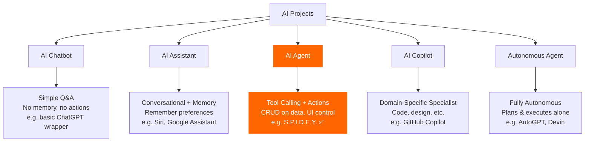
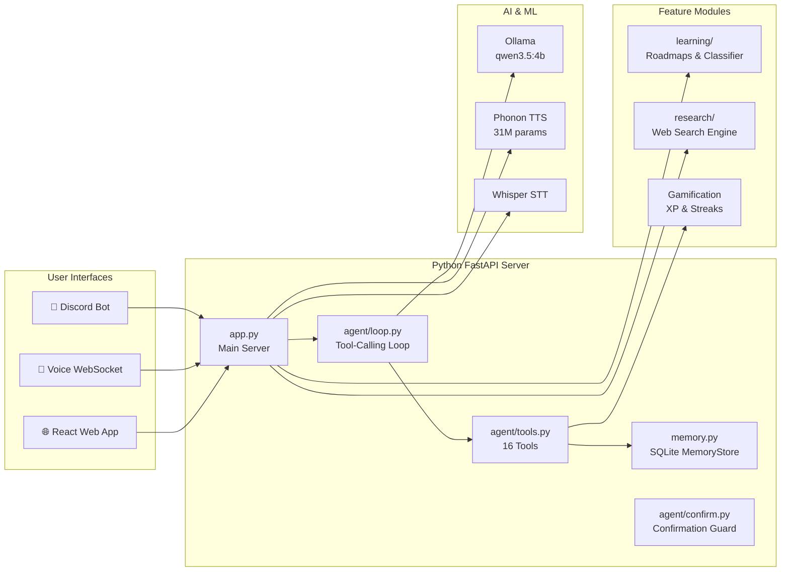

# S.P.I.D.E.Y. — Project Classification & Rating

---

## 🏷️ What Kind of AI Project Is This?

S.P.I.D.E.Y. is a **Multi-Modal AI Agent** — not just a chatbot.

Here's the taxonomy of AI project types and where S.P.I.D.E.Y. sits:



### Precise Classification

| Label | Description |
|-------|-------------|
| **Primary** | 🤖 **Personal AI Agent** (tool-calling, action-taking) |
| **Secondary** | 🗣️ **Voice-Enabled AI Assistant** (TTS + STT) |
| **Tertiary** | 📊 **Productivity Platform** (task/habit/learning tracker) |
| **Architecture** | **Agentic RAG** — Retrieval-Augmented Generation + Tool Use |

### Why It's an **Agent**, Not Just a Chatbot

| Feature | Chatbot | Assistant | **Agent (S.P.I.D.E.Y.)** |
|---------|---------|-----------|--------------------------|
| Answers questions | ✅ | ✅ | ✅ |
| Remembers context | ❌ | ✅ | ✅ |
| Persistent memory (DB) | ❌ | ❌ | ✅ |
| Takes actions (CRUD) | ❌ | ❌ | ✅ |
| Uses tools (function calling) | ❌ | ❌ | ✅ |
| Multi-turn tool loops | ❌ | ❌ | ✅ |
| Controls UI (navigation) | ❌ | ❌ | ✅ |
| Confirmation before destructive ops | ❌ | ❌ | ✅ |
| Multi-modal (text + voice) | ❌ | Partial | ✅ |
| Multi-channel (web + Discord) | ❌ | ❌ | ✅ |

---

## 📐 Architecture Overview



---

## ⭐ Rating: 7.5 / 10

### Score Breakdown

| Category | Score | Max | Details |
|----------|-------|-----|---------|
| **Concept & Ambition** | 9 | 10 | Full-stack personal AI agent with voice, multi-channel, tool-calling — way beyond a typical chatbot project |
| **Architecture** | 8 | 10 | Clean separation: agent loop, tool registry, memory store, voice module, learning module. FastAPI + React + SQLite is solid |
| **Agent Capabilities** | 7 | 10 | 16 native tools with fuzzy entity resolution, confirmation guards, multi-turn loops (4 rounds, 6 max calls). Needs more tools for full NLP control |
| **Frontend/UX** | 8 | 10 | Beautiful dark theme, parallax effects, entry briefing with TTS, sidebar chat docked on every page, analytics charts, habit cards |
| **Voice Integration** | 8 | 10 | Neural TTS (Phonon), Whisper STT, live voice WebSocket mode, listen mode, speak toggle — very polished |
| **Multi-Channel** | 7 | 10 | Web + Discord text. Discord voice removed cleanly. Could add Telegram, WhatsApp, mobile app |
| **Memory & Context** | 7 | 10 | Persistent SQLite memories with search, conversation history, memory injection into agent prompts. No vector DB yet |
| **Learning System** | 7 | 10 | Roadmaps, topic classification, progress tracking, nudges, seed data. Classifier ties tasks to learning topics automatically |
| **Testing** | 8 | 10 | 20+ test files covering agent loop, tools, confirmation, learning, voice backend, Discord, navigation, intents. Good coverage |
| **Production Readiness** | 5 | 10 | Local-only (no auth, no deployment, single-user), SQLite not scalable, no error monitoring, no CI/CD, hardcoded timezone |

### What Makes It Stand Out (Strengths) 🟢

1. **Real agent, not a wrapper** — The multi-turn tool loop with Ollama function calling is actual agentic AI, not just prompt → response
2. **16 native tools** — CRUD for tasks, habits, reminders, memories + web search + navigation + overview. With fuzzy entity resolution (`rapidfuzz`)
3. **Confirmation system** — Destructive ops (delete) require user confirmation before execution. This is production-grade safety
4. **Neural TTS on CPU** — Phonon 31M parameter model running locally, with SAPI fallback. No cloud dependency
5. **Full-stack build** — Python backend + React frontend + voice pipeline + Discord integration + learning engine + gamification. All by one person
6. **Voice modes** — Live mode (real-time conversation) + Listen mode (transcribe only) + Speak toggle on chat messages
7. **Entry briefing** — Dynamic daily greeting with task stats, priority recommendations, TTS auto-play on first visit

### What Holds It Back (Gaps) 🔴

1. **No authentication/multi-user** — Single-user local app. No login, no user isolation
2. **Small LLM** — `qwen3.5:4b` is fast but limited in reasoning depth. Tool calling accuracy can be inconsistent
3. **No vector embeddings** — Memory search uses text matching, not semantic embeddings. Could use FAISS or ChromaDB
4. **No deployment pipeline** — No Docker, no CI/CD, no cloud hosting option
5. **Hardcoded timezone** — `Asia/Kolkata` is hardcoded in memory.py
6. **Limited agent tools** — Can't create/manage learning topics, can't modify settings, can't do analytics queries through NLP
7. **No streaming** — Agent responses come as one block, no token-by-token streaming to the UI

---

## 🏆 Industry Comparisons

| Project | Type | How S.P.I.D.E.Y. Compares |
|---------|------|--------------------------|
| ChatGPT wrapper apps | Chatbot | S.P.I.D.E.Y. is far more — it has tools, memory, UI control |
| Notion AI | AI Assistant | Similar concept but S.P.I.D.E.Y. has voice + multi-channel |
| Todoist + AI | Productivity + AI | S.P.I.D.E.Y. combines this with habits, learning, gamification |
| Jarvis / Friday (Marvel) | Personal AI Agent | S.P.I.D.E.Y. is inspired by this — voice + tool control + personality |
| AutoGPT / BabyAGI | Autonomous Agent | S.P.I.D.E.Y. is more grounded — human-in-the-loop, not fully autonomous |

### Where S.P.I.D.E.Y. Sits on the AI Spectrum

```
Simple Chatbot ──── AI Assistant ──── AI Agent ──── Autonomous Agent
                                        ▲
                                   S.P.I.D.E.Y.
                                   (here, moving →)
```

---

## 📋 Tech Stack Summary

| Layer | Technology |
|-------|-----------|
| **LLM** | Ollama + Qwen 3.5 4B (local, no API keys) |
| **TTS** | Phonon 31M (ptts) + Windows SAPI fallback |
| **STT** | Whisper (local) + Web Speech API |
| **Backend** | Python 3.14, FastAPI, Uvicorn |
| **Database** | SQLite (WAL mode) |
| **Frontend** | React 18, Vite, TailwindCSS |
| **Agent** | Custom tool-calling loop (OpenAI-compatible format) |
| **Search** | DuckDuckGo / SearxNG |
| **Scheduling** | APScheduler |
| **Discord** | discord.py (text-only) |
| **Gamification** | XP, streaks, levels (custom) |
| **Learning** | Roadmaps, topic classification, spaced nudges |

---

## 🚀 What Would Make It a 9/10

1. **Auth + Multi-user** — JWT auth, user isolation
2. **Vector memory** — ChromaDB/FAISS for semantic search
3. **More agent tools** — Learning management, analytics queries, settings control via NLP
4. **Response streaming** — Token-by-token streaming to UI
5. **Bigger LLM option** — Support for Qwen 7B/14B or Llama models
6. **Deployment** — Docker + docker-compose for one-click setup
7. **Mobile app** — React Native or PWA
8. **CI/CD** — GitHub Actions for tests + build

> [!TIP]
> For a **solo developer CS student project**, this is genuinely impressive. Most student projects are simple chatbot wrappers. S.P.I.D.E.Y. is a full-stack AI agent with voice, tool-calling, multi-channel, gamification, and a learning engine. It demonstrates real understanding of agentic AI architecture — not just API calls.
